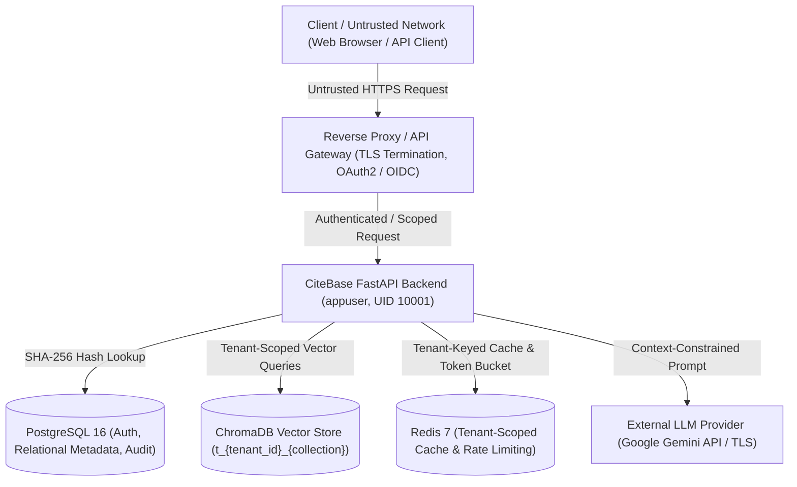
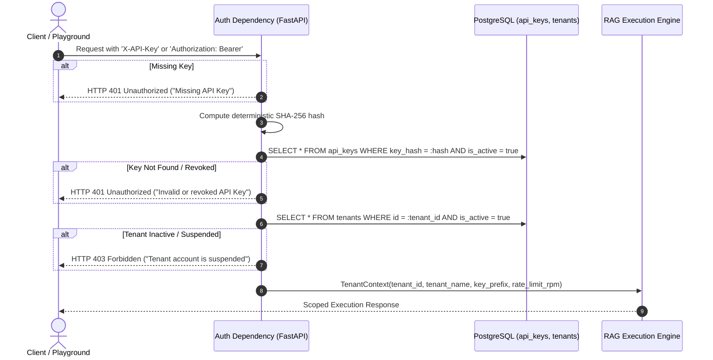

# CiteBase Security Specification & Architecture Model

## 1. Executive Summary & Objective

CiteBase is architected as an enterprise-grade, multi-tenant RAG-as-a-Service (Retrieval-Augmented Generation) document intelligence platform. Because the system manages proprietary tenant documents, performs dense/sparse vector index lookups, and synthesizes answers via large language models, security is a first-class architectural concern.

This document outlines the threat model, authentication lifecycle, multi-tenant partition boundaries, credential storage specifications, and production deployment hardening guidelines.

---

## 2. Threat Model & Trust Boundaries



### Assets Protected
1. **Tenant Documents & Ingested Content:** Raw PDFs and extracted textual chunks.
2. **Dense & Sparse Vector Indices:** 384-dimensional semantic embeddings in ChromaDB and BM25 inverted indices.
3. **Cached Query Responses:** LLM answers and citation metadata cached in Redis.
4. **Relational Records & Audit Trails:** Tenant metadata, API key hashes, ingestion tasks, and query execution logs in PostgreSQL.
5. **System Credentials:** Master bootstrap keys, database credentials, and external LLM provider API tokens.

### Threat Vectors & Mitigations
| Threat Vector | Potential Impact | CiteBase Architectural Mitigation |
|:---|:---|:---|
| **Cross-Tenant Data Leakage** | Tenant B discovers or queries Tenant A documents. | Cryptographic tenant resolution from SHA-256 key hash; strict runtime namespacing of vector collections (`t_{tenant_id[:12]}_{coll}`), BM25 indices, and Redis cache keys. |
| **API Key Brute-Force / Enumeration** | Attacker guesses high-entropy API keys. | Keys generated with 256 bits of entropy (`secrets.token_urlsafe(32)`); constant-time SHA-256 lookup; Redis sliding-window rate limiting per key. |
| **Plaintext Credential Compromise** | Database backup leak exposes raw API keys. | Plaintext keys are **never stored**. Only irreversible SHA-256 hashes are persisted in PostgreSQL. |
| **Application-Level XSS Exposure** | Injected JavaScript reads long-lived browser credentials. | Frontend playground migrates away from persistent `localStorage` to ephemeral `sessionStorage` scoped strictly to the active tab. |
| **Denial of Service via Heavy Ingestion / Queries** | Resource exhaustion crashing server. | Asynchronous background processing (HTTP 202); file size limits (`MAX_UPLOAD_BYTES = 50MB`); query text length limits (`max_length = 2000`); per-tenant sliding-window rate limiting. |
| **Prompt Injection / Grounding Bypass** | Malicious document content overrides generation prompt. | Context passages strictly wrapped in structured fences (`--- CONTEXT START ---`); system prompt instructs model to answer exclusively from numbered citations or return explicit refusal. |

---

## 3. Authentication & Tenant Resolution Flow



1. **Header Extraction:** Fast extraction from either `X-API-Key` or `Authorization: Bearer <key>`.
2. **SHA-256 Hash Matching:** Deterministic SHA-256 hash compared against database records.
3. **Dual Status Verification:** Requests fail closed unless both the API key and its owning Tenant record are explicitly active (`is_active = True`).
4. **TenantContext Propagation:** Downstream controllers receive a read-only, strongly typed `TenantContext` containing the tenant ID, name, rate limit, and key prefix.

---

## 4. Multi-Tenant Isolation Architecture

### 4.1 Relational Database Partitioning
Every entity in PostgreSQL (`DocumentRecord`, `IngestionTask`, `QueryLog`, `ApiKey`) enforces foreign-key linkage to a specific `tenant_id`. Application queries strictly enforce tenant scoping:
```sql
SELECT * FROM document_records WHERE tenant_id = :tenant_id AND collection_name = :coll;
```

### 4.2 Vector Database Namespacing & Tenant Isolation (ChromaDB)
To prevent cross-tenant vector contamination in ChromaDB, collections are dynamically prefixed using the tenant's full identifier:
```python
def get_scoped_collection_name(self, raw_collection_name: str) -> str:
    clean_name = raw_collection_name.strip()
    direct = f"t_{self.tenant_id}_{clean_name}"
    if len(direct) <= 63:
        return direct
    # Genuinely disjoint encoding scheme:
    # Client names cannot contain '.', so dot-separated hash-tailing is mathematically disjoint from all uncompressed names.
    prefix_base = f"t_{self.tenant_id}_"
    budget = 63 - len(prefix_base) - 1
    hash_len = min(16, max(8, budget))
    name_hash = hashlib.sha256(clean_name.encode("utf-8")).hexdigest()[:hash_len]
    prefix_budget = budget - hash_len
    if prefix_budget > 0:
        prefix = clean_name[:prefix_budget].rstrip("_-") or clean_name[:prefix_budget]
        return f"{prefix_base}{prefix}.{name_hash}"
    return f"t_{self.tenant_id}.{name_hash}"
```
Client names are canonicalized and validated at the API boundary (lowercase alphanumeric with `_` and `-`, 3–45 characters), preserving backward compatibility for legacy naming schemas. Total internal collection name length strictly satisfies ChromaDB's 63-character limit across all tenants (including long-named seeded tenants like `default_tenant_id`).

**Mathematical Disjointness vs. Cryptographic Collision Resistance:**
- **Proven Disjoint Separation:** Uncompressed physical collections never contain a period (`.`) because client collection names strictly disallow dots (`^[a-z0-9][a-z0-9_-]{1,43}[a-z0-9]$`). Compressed physical collection names always incorporate a period delimiter preceding the cryptographic hash (`.{name_hash}`). The intersection between the uncompressed namespace and the compressed namespace is empty ($\emptyset$), mathematically preventing any short logical name from colliding with an internal hash tail.
- **Collision Resistance Among Compressed Names:** For distinct long names requiring compression, uniqueness is protected by a 64-bit truncated SHA-256 digest (providing a high-entropy probabilistic guarantee where collision risk is $< 10^{-9}$ for 100,000 collections per tenant). At ingestion boundary (`/upload`), runtime uniqueness checks verify that a newly uploaded collection does not resolve to an identical physical collection as another logical collection for that tenant, rejecting collisions with HTTP 409 Conflict.
- **128-Bit Cryptographic Tenant Namespace Identity:** Tenant identifiers up to 32 characters (including standard 32-character hex UUIDs and legacy IDs) are used directly. Tenant identifiers longer than 32 characters (up to 64 characters) dynamically derive a full 128-bit cryptographic namespace token via 32 hexadecimal characters of SHA-256 (`hashlib.sha256(tid).hexdigest()[:32]`), providing full 128-bit collision resistance ($P < 10^{-18}$) and unconditionally guaranteeing total physical collection length $\le 63$ across all tenant IDs up to 64 chars and all collection names up to 45 chars.
- **Defense-in-Depth Cross-Tenant Isolation:** Even under hypothetical or engineered collisions where two distinct long tenant IDs share the exact same physical collection namespace:
  - **Upload boundary (`/upload`):** Detects if the target physical collection is already owned by or mapped to another tenant in ChromaDB metadata or relational storage, rejecting cross-tenant overwrites with HTTP 409 Conflict.
  - **Query boundary (`/query`):** Enforces collection accessibility rules; if a physical collection exists in ChromaDB but is owned by another tenant, it is omitted from target search pools, returning 0 sources to the unauthorized caller.
  - **Deletion boundary (`DELETE /collections/{name}`):** Verifies collection ownership; attempts to delete collections owned by other tenants are rejected with HTTP 404 (`CollectionNotFoundError`), preserving underlying vectors, index files, and relational records intact.

**Physical Deletion Atomicity & Observability:**
Collection deletion (`DELETE /collections/{name}`) and tenant reset (`POST /reset`) execute physical vector removal in ChromaDB and sparse index deletion on disk before modifying database state:
1. **Specific Missing-Collection Recognition:** `ValueError` from ChromaDB is only treated as "already deleted" if the exception specifically confirms the collection is absent (`"does not exist"`). Any unrecognized `ValueError` or unexpected deletion error raises HTTP 500 and halts deletion.
2. **Comprehensive BM25 Cleanup (.json & legacy .pkl):** Existence checks and cleanup routines inspect both active `.json` and legacy `.pkl` index files. File-removal exceptions during BM25 index deletion (`delete_bm25_index`) are propagated to the API boundary as HTTP 500 (`"Incomplete collection deletion: failed to remove persistent BM25 index"`), preventing silent retention of plaintext chunks.
3. **Orphaned BM25 Sidecar Ownership Verification:** BM25 files record root-level `tenant_id` metadata. In the event of orphaned BM25 files (vector collection deleted but sparse index retained on disk), `DELETE /collections/{name}` inspects disk sidecars (`get_bm25_file_tenant_id`) and relational database records. Deletion is rejected with HTTP 404 (`CollectionNotFoundError`) if ownership belongs to another tenant or cannot be verified when `doc_count == 0`.
4. **Tenant Reset Atomicity (`/reset`):** `/reset` tracks deletion status per collection. For collections lacking metadata, relational ownership is verified fail-closed. If physical deletion in ChromaDB or BM25 fails for any collection, its relational `DocumentRecord` rows are preserved, and HTTP 500 is returned reporting incomplete reset.
5. **Relational Record Consistency:** Relational `DocumentRecord` rows in PostgreSQL/SQLite are only deleted after both ChromaDB vector deletion and BM25 index file deletion have definitively succeeded. If any failure occurs, relational records remain intact, preserving consistent state and enabling safe retries.

**Fail-Closed Query Isolation on Missing Ownership Metadata:**
When ChromaDB collection metadata lacks explicit `tenant_id` ownership (e.g. from third-party or legacy ingestion), `is_collection_accessible_to_tenant()` strictly evaluates foreign relational records first. If any other tenant owns documents under that logical collection name, access is denied immediately (`False`), preventing shared chunk leakage. Ingestion (`embed_and_store`) strictly fails with `RuntimeError` if collection ownership metadata cannot be established, eliminating unowned collections.

**Pre-Migration v6 Namespace Compatibility:**
To maintain continuous access for collections created under prior v6 naming schemes (where tenant IDs > 32 characters were unhashed for 33–36 characters or used `tid[:24] + sha256[:8]`), `TenantContext.get_pre_migration_scoped_collection_name()` provides a dedicated compatibility resolver. Collections created under this scheme remain fully discoverable via `GET /collections`, queryable via `POST /query`, and deletable via `DELETE /collections/{name}`.

**Strict Legacy Resolver Isolation Guard:**
To support existing installations without orphaning pre-migration data, legacy collection lookups (`t_{tenant_id[:12]}_{clean_name}`) are strictly guarded:
- Only verified legacy tenants (`len(tenant_id) <= 12` or seeded default tenants) are permitted to resolve legacy collections.
- For all modern 32-character UUID tenants, `get_legacy_scoped_collection_name()` unconditionally returns `None`.
- Even if a modern tenant's 32-character UUID shares its first 12 characters with an older legacy tenant, the modern tenant cannot resolve, query, or delete the legacy tenant's collections via `/query` or `DELETE /collections/{name}`.

### 4.3 Sparse Keyword Index Isolation (BM25)
BM25 sparse indices are saved atomically on disk using paths scoped strictly by the internal collection identifier:
`{CHROMA_PATH}/{scoped_collection_name}_bm25.json`
Tenant collections cannot access, read, or overwrite index files belonging to other organizations.

### 4.4 Cache Partitioning (Redis)
All Redis response cache keys are strictly namespaced by tenant ID and include all result-affecting query options:
`rag_cache:{tenant_id}:{query_sha256}`
The cache key hashes the normalized question, target collections, metadata filters, reranker state, web-fallback toggle, and web search provider. Even if Tenant A and Tenant B ask the exact same question against their own collections, Tenant B will **never** receive Tenant A's cached response.

### 4.5 Background Ingestion & Durability Boundary (Documented Architectural Limitation)
> [!NOTE]
> **Architectural Status — Durability Not Implemented (Documented Limitation)**:
> Ingestion tasks execute asynchronously in-process via FastAPI `BackgroundTasks`. While relational task metadata and active worker heartbeats (`updated_at`) are maintained in PostgreSQL, in-flight task execution is not durable across host reboots, process crashes, or container terminations.
> - **Liveness vs. Progress:** The daemon heartbeat thread tracks worker thread liveness, allowing slow, heavy parsing operations to continue without premature timeout. However, heartbeat renewal indicates thread existence rather than incremental progress metrics. If an underlying PDF extraction or embedding library hangs indefinitely in native C code, heartbeats continue until the container or process is terminated. Distributed durability, incremental progress reporting, and task leasing via external brokers (e.g. Celery + Redis/RabbitMQ or AWS SQS) are documented architectural milestones for distributed multi-node production.

---

## 5. API Key Lifecycle & Storage

### 5.1 High-Entropy Generation
Keys are generated using Python's cryptographically secure pseudo-random number generator (`secrets.token_urlsafe(32)`), producing 256 bits of entropy. Keys are formatted with standard prefixes:
`sk_live_{token}`

### 5.2 Irreversible Storage
Plaintext API keys are **never stored** in persistent storage.
- At generation time, the plaintext token is displayed to the administrator exactly once.
- The database stores only `key_hash = hashlib.sha256(raw_key.encode('utf-8')).hexdigest()`.
- For operational logging and operator identification, an abbreviated 12-character prefix is recorded (`key_prefix = raw_key[:12]`, e.g. `sk_live_a1b2...`).

### 5.3 Zero-Downtime Rotation Protocol
To rotate credentials without downtime:
1. Issue an API call or administrative migration creating a new active `ApiKey` for the tenant.
2. Update client configuration / API consumer systems with the new key.
3. Validate that requests succeed under the new key prefix in audit logs.
4. Revoke the old key by setting `is_active = False`. The change takes effect immediately across all instances.

---

## 6. Rate Limiting & Abuse Prevention

CiteBase utilizes Redis sliding-window token counters to enforce tenant quotas (`rate_limit_rpm`):
- **Per-Key Scoping:** Rate limits are tracked per active API key ID: `rate_limit:{api_key_id}:{current_minute}`.
- **HTTP 429 Response:** Exceeded quotas return HTTP 429 with informative response headers:
  ```http
  HTTP/1.1 429 Too Many Requests
  Retry-After: 60
  X-RateLimit-Limit: 60
  X-RateLimit-Remaining: 0
  ```
- **Fail-Open In-Memory Fallback:** If Redis is temporarily unreachable, the rate limiter falls back to an in-memory dictionary counter with logged warnings, preventing service interruption while continuing to monitor burst anomalies.

---

## 7. CORS Policy & Client-Side Security

### 7.1 Cross-Origin Resource Sharing (CORS)
Allowed origins are configured strictly via environment variables (`ALLOWED_ORIGINS`):
```python
app.add_middleware(
    CORSMiddleware,
    allow_origins=ALLOWED_ORIGINS,
    allow_credentials=True,
    allow_methods=["GET", "POST", "DELETE", "OPTIONS"],
    allow_headers=["*"],
)
```
Wildcard `*` origins are strictly prohibited in production configurations.

### 7.2 Developer Playground vs. Production Architecture
- **Developer Playground (Development / QA Mode):**
  - Designed for interactive exploration and multi-tenant testing.
  - The browser frontend (`frontend/app.js`) passes `X-API-Key` headers directly.
  - Credentials are stored strictly in `sessionStorage` (isolated to the browser tab) and never persisted in long-lived `localStorage`.
- **Production Architecture (B2B Consumer Mode):**
  - Browser applications never store or directly inject privileged master API keys.
  - Requests terminate at an API Gateway / Reverse Proxy (e.g., Kong, Envoy, Cloudflare).
  - Client authentication utilizes OAuth2/OIDC (JWT Bearer tokens or HTTP-only secure session cookies).
  - The Gateway resolves user identity and injects verified tenant context headers downstream to CiteBase.

---

## 8. Production Deployment Hardening & Fail-Closed Guards

### 8.1 Fail-Closed Configuration
In production mode (`ENV=production`):
- CiteBase validates that `BOOTSTRAP_API_KEY` is not empty and is not set to any disallowed default or template placeholder.
- If an insecure or placeholder key is detected, the application halts startup immediately with an `EnvironmentError`, refusing to expose the service.
- Docker Compose files enforce mandatory variable presence (`${POSTGRES_PASSWORD:?Error...}`), preventing silent fallbacks to known public passwords.

### 8.2 Container Security
The production Docker container implements enterprise container security best practices:
- **Non-Root Execution:** Runs under dedicated unprivileged user `appuser` (UID 10001, GID 10001).
- **Multi-Stage Build:** Build tools (gcc, g++, make) are purged from the final runtime image.
- **Automated Healthchecks:** Healthchecks periodically verify `/health` endpoint, PostgreSQL connectivity, and Redis responsiveness.

---

## 9. Security Advisory & Historical Credential Disclosure (Option A)

> [!IMPORTANT]
> **Historical Credential Notice**:
> In early development revisions (specifically ancestor commit `463affdfe750148aebfc098b70d17a7ebd759f20`), a credential-shaped development placeholder was committed in configuration templates.
> - **Operational Status:** This placeholder was strictly a local development template value and was **never** connected to or valid on any external production system.
> - **Eradication:** The credential-shaped placeholder has been completely purged from all active tracked repository files (`.env.example`, `docker-compose.yml`, `frontend/app.js`, `frontend/index.html`, `README.md`, `tests/conftest.py`).
> - **Fail-Closed Block:** The backend configuration in `backend/config.py` enforces fail-closed validation (`is_insecure_bootstrap_key()`), permanently blocking startup if development placeholders or template values are supplied when `ENV=production`.
> - **Git History Notice:** To maintain downstream Git clone integrity and preserve immutable commit SHAs on `main` without destructive force-pushes, historical commits are preserved under Option A. Full-history scanners (e.g. GitGuardian) will flag the historical ancestor commit, but active repository trees contain zero active credentials or literal tokens.

---

## 10. Reporting a Vulnerability

If you discover a potential security vulnerability within CiteBase, please report it responsibly:
- **Email:** security-reports@citebase.dev (or contact repository maintainer [GurutejaReddy-04](https://github.com/GurutejaReddy-04))
- **Disclosure Policy:** We request that you provide reasonable time for investigation and remediation before public disclosure. We commit to acknowledging receipt within 48 hours and providing regular remediation status updates.
